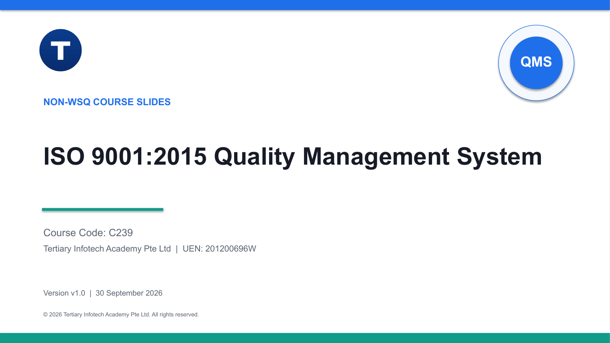

# ISO 9001:2015 Quality Management System

A practical, one-day introduction to ISO 9001:2015 — from quality principles and the clause structure to KPIs, internal audit and corrective action — built around one connected Singapore SME case.

| Course detail | Information |
|---|---|
| Course code | `C239` |
| Programme | Non-WSQ |
| Duration | 1 day · 7.5 instructional hours (9:30am – 5:30pm) |
| Registration | [View course details and register](https://www.tertiarycourses.com.sg/iso-9001-2015-quality-management-system.html) |



## About the course

A quality management system is how an organisation delivers consistently, not a folder of procedures. This course explains what ISO 9001:2015 expects and why: you work through quality and its business value, the seven quality management principles, the process approach and PDCA, and the intent of clauses 4–10. Then you apply them to a fictional precision-components manufacturer, LionCity Precision Components (LPC). You diagnose quality gaps, map and improve a process, select quality tools, set KPIs, evaluate a process against requirements, run an internal audit simulation, follow up a nonconformity and document the resulting improvement. Evidence and decisions carry forward from one activity to the next.

## Learning outcomes

By the end of the course you will be able to:

- Identify areas for improvement using an ISO 9001 quality management system and perform process improvement.
- Apply appropriate quality tools and monitor relevant quality metrics and KPIs.
- Evaluate processes and assess compliance against quality management system requirements.
- Follow up the QMS improvement process and document continual improvement according to organisational procedures.

## Topics covered

1. **Quality foundations** — quality, QMS, the ISO 9000 family, certification, the seven principles and the process approach.
2. **Planning, support and operation** — context, leadership, risks and opportunities, quality objectives, support, documented information and operational control.
3. **Performance evaluation** — monitoring, measurement, analysis, customer satisfaction, internal audit and management review.
4. **Continual improvement** — nonconformity, root cause, corrective action, effectiveness checks and improvement reporting.

## Activities

Each activity folder holds a detailed `README.md` procedure, a printable PDF scenario and checklist, and an editable Excel workbook. Start from the [activities index](activities/README.md).

| # | Activity | Topic |
|---|---|---|
| A1 | [Diagnose Quality Gaps from Evidence](activities/activity-01-quality-gap-diagnosis/README.md) | 1 |
| A2 | [Map and Improve the Order-to-Delivery Process](activities/activity-02-order-to-delivery-process/README.md) | 1 |
| A3 | [Select and Apply Quality Tools](activities/activity-03-quality-tools/README.md) | 2 |
| A4 | [Set Quality Objectives and KPIs](activities/activity-04-quality-objectives-kpis/README.md) | 2 |
| A5 | [Evaluate a Process Against QMS Requirements](activities/activity-05-qms-process-evaluation/README.md) | 3 |
| A6 | [Conduct an Internal Audit Simulation](activities/activity-06-internal-audit-simulation/README.md) | 3 |
| A7 | [Follow Up a Nonconformity and Corrective Action](activities/activity-07-nonconformity-corrective-action/README.md) | 4 |
| A8 | [Document the Continual Improvement Report](activities/activity-08-continual-improvement-report/README.md) | 4 |

## Courseware package

| Material | Editable | PDF |
|---|---|---|
| Trainer slide deck (v1.0, 141 slides) | [PPTX](courseware/ISO%209001-2015%20Quality%20Management%20System-v1.0.pptx) | [PDF](courseware/ISO%209001-2015%20Quality%20Management%20System-v1.0.pdf) |
| Lesson Plan | [DOCX](courseware/LP-ISO%209001-2015%20Quality%20Management%20System.docx) | [PDF](courseware/LP-ISO%209001-2015%20Quality%20Management%20System.pdf) |
| Learner Guide | [DOCX](courseware/LG-ISO%209001-2015%20Quality%20Management%20System.docx) | [PDF](courseware/LG-ISO%209001-2015%20Quality%20Management%20System.pdf) |

```text
.
├── courseware/        slide deck, Lesson Plan and Learner Guide (editable + PDF)
├── activities/        eight self-contained activity packs (A1–A8)
└── courseware-cover.png
```

Clone the activities with:

```bash
git clone https://github.com/tertiarycourses/C239--ISO-9001-2015-Quality-Management-System.git
```

## Standard-use note

This training package paraphrases ISO 9001 concepts for education and does not reproduce the copyrighted standard. Organisations should use a licensed copy of ISO 9001 for formal interpretation and certification work.

## Distribution

This repository publishes the learner-facing courseware and activity packs. Trainer-only source references are kept in controlled storage and are not part of this repository. All case data (LPC) is fictional; use only fictional, anonymised or authorised workplace information in your own work.

## Provider

Developed and delivered by **[Tertiary Infotech Academy Pte Ltd](https://www.tertiarycourses.com.sg/)** (UEN 201200696W). ISO and ISO 9001 are trademarks of the International Organization for Standardization.
